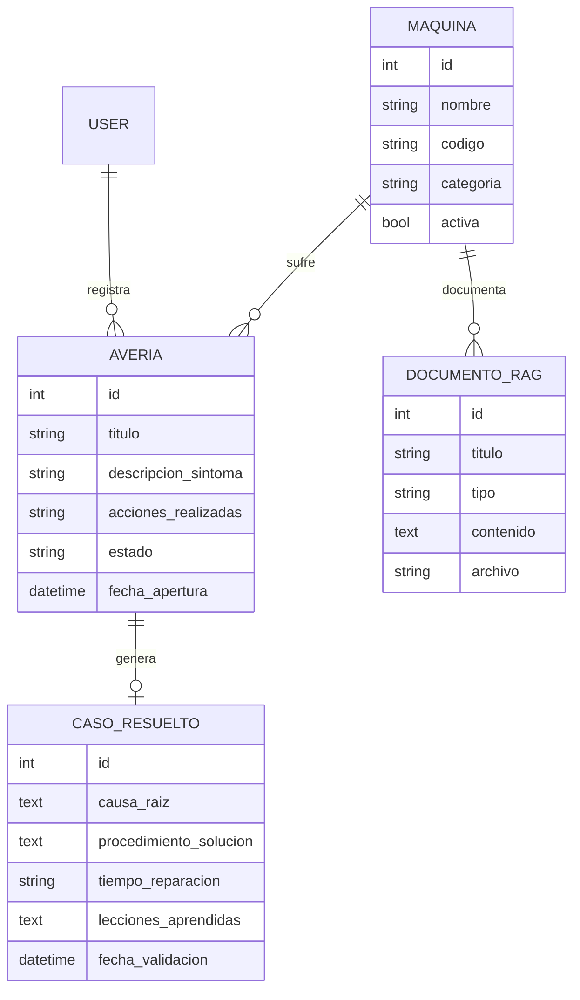

# Arquitectura

## Diagrama entidad-relación



## Arquitectura de componentes

```
Usuario
  │
  ▼
React + Vite  ──HTTP/JSON──▶  Django REST Framework
                                  │
                                  ├─ Autenticación y permisos
                                  ├─ Serializadores y validación
                                  ├─ Servicio de búsqueda RAG (palabras clave)
                                  │
                                  ▼
                              Django ORM ──▶ PostgreSQL
```

## Responsabilidades por capa
- **React:** formularios, tablas, estados de carga/error. No es la
  barrera de seguridad.
- **DRF:** valida, serializa y aplica permisos por endpoint.
- **Servicios de negocio (Django):** lógica como "crear CasoResuelto
  solo si hay causa y procedimiento", separada de las vistas.
- **PostgreSQL:** persistencia relacional.